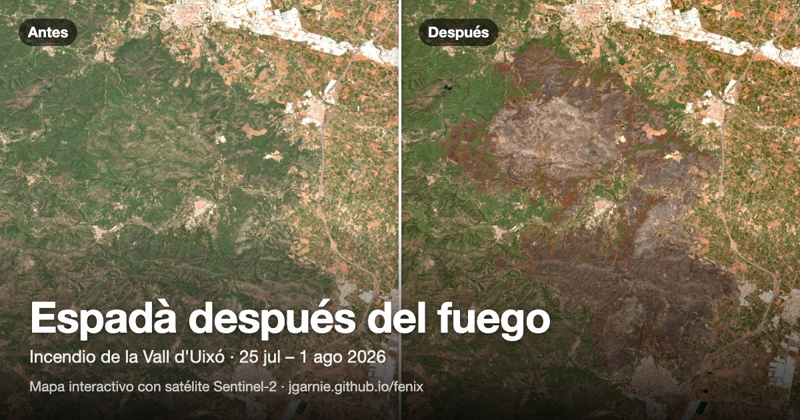

# Fénix · después del fuego

**[Ver la app →](https://jgarnie.github.io/fenix/)** · [Espadà 2026](https://jgarnie.github.io/fenix/) · [Bejís 2022](https://jgarnie.github.io/fenix/bejis/) · [Tiétar 2026](https://jgarnie.github.io/fenix/tietar/) · [Alto Mijares 2023](https://jgarnie.github.io/fenix/villanueva-de-viver/)

[](https://jgarnie.github.io/fenix/)

Qué había, qué se quemó, de quién es el monte y cómo podría recuperarse, a partir de imágenes de satélite y cartografía
pública, en un mapa que funciona en el móvil.

Hecho por **Joaquín García Nieto** · [LinkedIn](https://www.linkedin.com/in/jgarnie/) · [garcia.nieto.joaquin@gmail.com](mailto:garcia.nieto.joaquin@gmail.com).
¿Quieres usarlo en tu municipio o asociación, colaborar o proponer otro incendio? Escríbeme.

> Proyecto independiente y divulgativo. No es una fuente oficial.

## Qué incluye

Mapas interactivos de cuatro grandes incendios forestales:

- **Espadà** (`public/`): incendio de la Vall d'Uixó / Serra d'Espadà (25 jul – 1 ago 2026).
- **Bejís** (`public/bejis/`): incendio de Bejís, Alto Palancia (agosto 2022), con imágenes de cada verano hasta 2026
  para seguir la recuperación.
- **Tiétar** (`public/tietar/`): incendio de Burgohondo, Alberche y valle del Tiétar (Ávila y oeste de Madrid, julio 2026).
  Fuera de la Comunitat Valenciana: las capas salen de fuentes nacionales y autonómicas (ver tabla).
- **Alto Mijares** (`public/villanueva-de-viver/`): incendio de Villanueva de Viver (marzo 2023), que cruzó de Castellón a Teruel.
  Las capas continúan entre comunidades: catálogos de montes de la Generalitat y de Aragón, y fuentes nacionales para el resto.

Los cuatro usan el mismo visor (`public/app.js`); los textos propios de cada incendio están en su `fire.js`.

- **Antes / después / ahora:** comparador deslizante con imágenes Sentinel-2 (color natural y falso color) y ortofoto PNOA.
- **Capas:** severidad del fuego (dNBR), monte público (catálogo de utilidad pública), vegetación previa (Mapa Forestal de España),
  vegetación potencial (Mapa de Series de Vegetación de España, MITECO), riesgo de erosión, rebrote observado e incendios anteriores.
- **Árboles quemados:** estimación a partir de las parcelas del Inventario Forestal Nacional dentro del área quemada.
- **Términos municipales** y hectáreas quemadas en cada uno.
- **Análisis de la Fundación CEAM** reproducidos con datos abiertos: sequedad de la vegetación antes del incendio, su criterio para decidir dónde reforzar la regeneración (30 % y 60 % de cobertura de leñosas rebrotadoras, evaluado a 1–2 años del incendio), los parajes que cita y una comparación de cifras.
- **Ficha de cada punto:** al pulsar el mapa, qué había, qué debería haber, de quién es, la viabilidad de recuperarlo y cómo actuar.
- **Plan:** superficie y coste por actuación según el alcance. Los costes salen de tarifas forestales oficiales y se pueden editar.
- **Para asistentes de IA:** resúmenes en JSON (`public/api/`) y un servidor MCP ([`mcp/`](mcp/README.md)) para preguntar a Claude, ChatGPT u otros por los incendios o por un punto concreto. En Claude Desktop basta con [descargar la extensión `fenix.mcpb`](https://github.com/jgarnie/fenix/releases/latest/download/fenix.mcpb) y hacer doble clic.

## Ejecutar

```bash
python3 -m http.server 5173 -d public   # abre http://localhost:5173
```

## Regenerar los datos

```bash
pip3 install geopandas rasterio pillow access-parser
python3 scripts/build_data.py           # Espadà: descarga a data-raw/ (no versionado) y escribe public/data/
python3 scripts/trees.py                # estimación de árboles quemados (Inventario Forestal Nacional)
python3 scripts/build_data.py bejis     # Bejís: data-raw/bejis/ → public/bejis/data/
python3 scripts/trees.py bejis
python3 scripts/build_data.py tietar    # Tiétar: data-raw/tietar/ → public/tietar/data/
python3 scripts/trees.py tietar
python3 scripts/build_data.py villanueva-de-viver   # Alto Mijares: data-raw/villanueva-de-viver/ → public/villanueva-de-viver/data/
python3 scripts/trees.py villanueva-de-viver
node scripts/build_api.mjs              # resúmenes JSON para IAs y el servidor MCP → public/api/ (sí se versiona)
python3 scripts/build_point.py          # rejilla troceada para el MCP remoto → data/point.json + point.bin.gz
```

Los datos generados (`public/data/` y `public/bejis/data/`) no se versionan en este repo: la web publicada los lee del repo
[fenix-data](https://github.com/jgarnie/fenix-data) (`vallduixo/data/`, `bejis/data/`, `tietar/data/` y `villanueva-de-viver/data/`), que solo guarda la última versión.
En local se usan las carpetas de `public/`. Tras regenerarlos, publícalos con:

```bash
scripts/publish_data.sh
```

## Datos y licencias

| Datos | Fuente | Licencia / condiciones |
|---|---|---|
| Área quemada | © Unión Europea, Copernicus Emergency Management Service (EMSR905 Espadà, EMSR625 Bejís, EMSR900 Tiétar, EMSR656 Villanueva de Viver) | [Condiciones de Copernicus EMS](https://mapping.emergency.copernicus.eu/terms-and-conditions/): reproducción autorizada citando la fuente |
| Imágenes | Contiene datos modificados de Copernicus Sentinel (2022–2026), vía Earth Search (Element 84) | Datos Copernicus de acceso libre y abierto |
| Ortofotos | PNOA histórico (2021, 2024), © Instituto Geográfico Nacional | CC BY 4.0 scne.es |
| Relieve | Copernicus DEM GLO-30: © DLR e.V. 2010-2014 y © Airbus Defence and Space GmbH 2014-2018, suministrado bajo COPERNICUS por la UE y la ESA | Licencia Copernicus DEM |
| Montes, Mapa Forestal 1:50.000, Parque Natural, incendios 1993–2024 | Institut Cartogràfic Valencià / Generalitat Valenciana (el Mapa Forestal de España es obra del MITECO) | CC BY 4.0 |
| Términos municipales | Institut Cartogràfic Valencià | CC BY 4.0 |
| Tiétar: montes de utilidad pública | Junta de Castilla y León (IDECyL) y Comunidad de Madrid (IDEM) | Datos abiertos de cada comunidad |
| Tiétar: Mapa Forestal 1:50.000 y Espacios Naturales Protegidos | MITECO, Banco de Datos de la Naturaleza | Datos públicos del Banco de Datos de la Naturaleza |
| Tiétar: términos municipales | Instituto Geográfico Nacional | CC BY 4.0 scne.es |
| Alto Mijares: montes públicos de Aragón | Gobierno de Aragón (IDEAragon) | Datos abiertos del Gobierno de Aragón |
| Alto Mijares: Mapa Forestal, ENP, municipios, incendios previos | MITECO, IGN, EFFIS (más ICV/GVA en la parte valenciana) | Ver filas anteriores |
| Tiétar: incendios 2016–2025 | EFFIS, © Unión Europea, Copernicus | Condiciones de Copernicus |
| Árboles por hectárea | Tercer Inventario Forestal Nacional (IFN3), Castellón y Valencia, MITECO | Datos públicos del Banco de Datos de la Naturaleza |
| Geología | IGME-CSIC, GEODE 1:50.000 | CC BY 4.0 |
| Vegetación potencial | Mapa de Series de Vegetación de España (S. Rivas-Martínez, 1987), Banco de Datos de la Naturaleza, MITECO. Especies: Rivas-Martínez y col. (2011), *Itinera Geobotanica* 18(1) | Datos públicos del Banco de Datos de la Naturaleza; la memoria solo se cita |
| Mapa base y ortofoto (se cargan en directo) | Instituto Geográfico Nacional | CC BY 4.0 scne.es |
| Precios unitarios | Tarifas forestales de la Junta de Extremadura (2024); recargos de VAERSA según el DOGV (30/9/2025) | Documentos públicos (solo se citan cifras) |
| Leaflet | Volodymyr Agafonkin y colaboradores | BSD-2-Clause (`public/vendor/leaflet/LICENSE`) |

Las capas derivadas (severidad, actuaciones, viabilidad y costes) son elaboración propia y
ninguno de los organismos citados las ha revisado ni respaldado. El código está bajo licencia MIT (ver `LICENSE`).

## Aviso

Proyecto independiente con fines informativos y divulgativos. **No es una fuente oficial** y no tiene relación con la
Generalitat Valenciana, el Ministerio ni ningún otro organismo. No debe usarse para tomar decisiones de emergencia,
delimitar propiedades ni sustituir el criterio de técnicos forestales. Los datos y resultados se ofrecen tal cual, sin garantía.

La capa de propiedad procede del catálogo público de montes y no contiene datos de propietarios particulares.
La aplicación no usa cookies ni analítica. Las teselas del mapa base se cargan desde los servidores del IGN.
